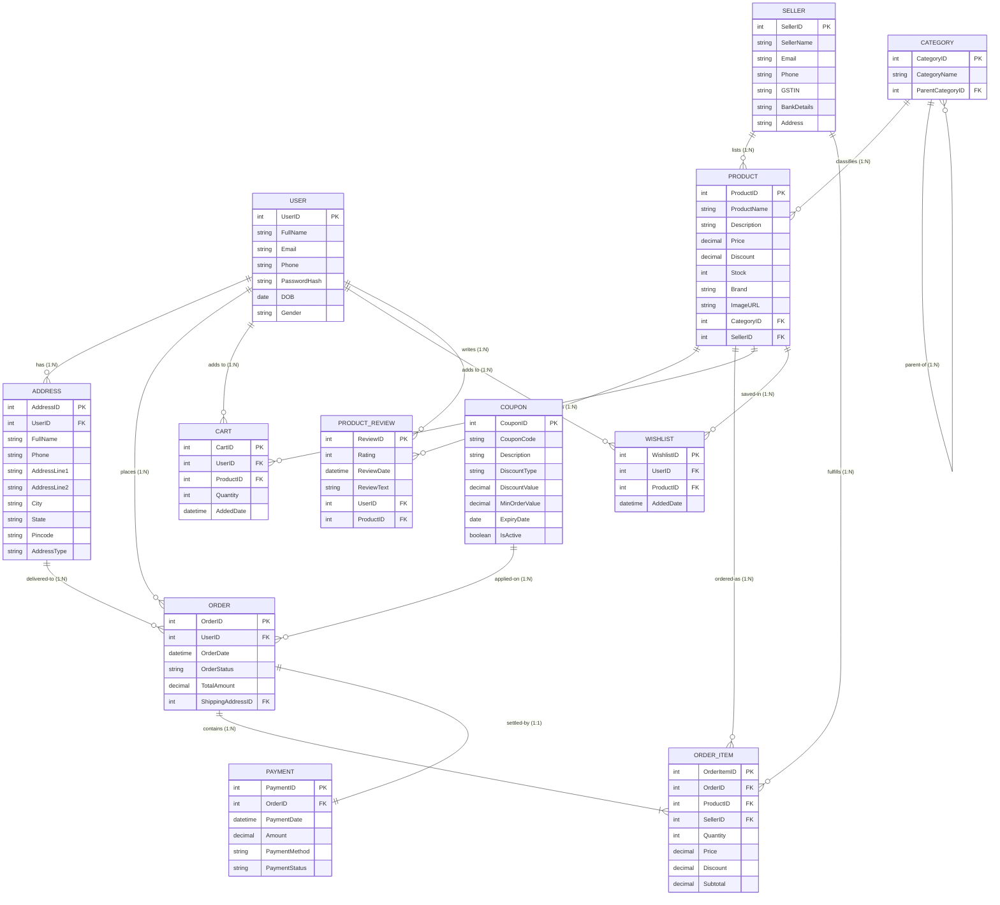

# Experiment - 1

## Title
**Design an ER Diagram for an Indian E-Commerce Platform**

---

## Aim
To design an **Entity Relationship (ER) Diagram** for an Indian E-Commerce Platform with entities **Customer/User, Product, Order, Seller, Category, Payment, Delivery, and Address**, including primary keys, composite and multi-valued attributes, weak entities, specialization of Product, and participation constraints.

---

## Theory
An **Entity Relationship (ER) Model** is a high-level conceptual data model used in database design. It visually represents the structure of a database by defining real-world entities, their relevant attributes, and the relationships existing among them.

### Key Components

1. **Entity**: A distinct real-world object or thing that has independent existence and is distinguishable from other objects (represented by a **Rectangle**).
2. **Attribute**: A characteristic or property of an entity (represented by an **Oval**).
3. **Primary Key**: An attribute or combination of attributes that uniquely identifies each instance of an entity (underlined attribute).
4. **Composite Attribute**: An attribute composed of multiple sub-attributes (e.g., *Address* composed of *AddressLine1, AddressLine2, City, State, Pincode*).
5. **Multi-valued Attribute**: An attribute that can hold more than one value for a given entity instance (e.g., multiple contact numbers, represented by a double oval).
6. **Weak Entity**: An entity that cannot be uniquely identified by its own attributes alone and relies on a foreign key relationship with an identifying/owner entity (represented by a **Double Rectangle**).
7. **Relationship**: An association among two or more entities (represented by a **Diamond**).
8. **Specialization**: The process of defining a set of subclasses of an entity type; dividing a generalized entity into distinct categories based on distinguishing characteristics (e.g., *Product* specialized into *Electronics, Clothing, Groceries*).
9. **Participation Constraint**: Specifies whether the existence of an entity depends on its being related to another entity via the relationship type:
   - **Total Participation (Mandatory)**: Every entity instance must participate in the relationship (represented by a double line).
   - **Partial Participation (Optional)**: Only some entity instances participate in the relationship (represented by a single line).

---

## Entity-Relationship Specifications

### 1. USER (`Customer`)
Represents registered users/customers on the e-commerce platform.
- **`UserID`** `[PK]`: Unique identifier for each user.
- **`FullName`**: Customer's full name.
- **`Email`**: Unique email address.
- **`Phone`**: Registered mobile number (10-digit Indian standard).
- **`PasswordHash`**: Encrypted login credential.
- **`DOB`**: Date of birth.
- **`Gender`**: Gender identity.

### 2. ADDRESS
Represents shipping and billing addresses linked to a customer.
- **`AddressID`** `[PK]`: Unique address identifier.
- **`UserID`** `[FK]`: Identifies the owning customer.
- **`FullName`**: Name of recipient.
- **`Phone`**: Contact number for delivery agent.
- **`AddressLine1`**, **`AddressLine2`**: Street details, flat/house number, landmark.
- **`City`**, **`State`**: City and Indian State/UT.
- **`Pincode`**: 6-digit Indian postal code.
- **`AddressType`**: Category of address (`Home` / `Work` / `Other`).

### 3. SELLER
Represents verified Indian merchants listed on the platform.
- **`SellerID`** `[PK]`: Unique merchant ID.
- **`SellerName`**: Business/Store registered name.
- **`Email`**: Merchant contact email.
- **`Phone`**: Business helpline / phone number.
- **`GSTIN`**: 15-digit Goods and Services Tax Identification Number (mandatory for Indian e-commerce sellers).
- **`BankDetails`**: Account number and IFSC for disbursement.
- **`Address`**: Merchant warehouse / registered office address.

### 4. CATEGORY
Hierarchical categorization of products (e.g., Electronics &rarr; Mobiles &rarr; Smartphones).
- **`CategoryID`** `[PK]`: Unique category code.
- **`CategoryName`**: Category title.
- **`ParentCategoryID`** `[FK]`: Self-referencing key for subcategories.

### 5. PRODUCT
Items offered for purchase on the marketplace.
- **`ProductID`** `[PK]`: Unique stock item code.
- **`ProductName`**: Name of the item.
- **`Description`**: Detailed specifications and features.
- **`Price`**: Listed MRP / selling price in INR (₹).
- **`Discount`**: Applied percentage/amount discount.
- **`Stock`**: Available quantity in inventory.
- **`Brand`**: Manufacturer / brand label.
- **`ImageURL`**: URL pointing to product catalog image.
- **`CategoryID`** `[FK]`: Reference to Category.
- **`SellerID`** `[FK]`: Reference to Seller.

### 6. ORDER
Records transactions placed by customers.
- **`OrderID`** `[PK]`: Unique order transaction identifier.
- **`UserID`** `[FK]`: Customer who placed the order.
- **`OrderDate`**: Timestamp when order was placed.
- **`OrderStatus`**: `Pending`, `Confirmed`, `Shipped`, `Out for Delivery`, `Delivered`, `Cancelled`.
- **`TotalAmount`**: Net payable amount after discounts and taxes.
- **`ShippingAddressID`** `[FK]`: Delivery destination address.

### 7. ORDER_ITEM (`Weak Entity / Composite Entity`)
Line items contained in an order.
- **`OrderItemID`** `[PK]`: Unique line item reference.
- **`OrderID`** `[FK]`: Associated order.
- **`ProductID`** `[FK]`: Specific product purchased.
- **`SellerID`** `[FK]`: Merchant fulfilling this unit.
- **`Quantity`**: Number of units.
- **`Price`**: Unit purchase price.
- **`Discount`**: Discount applied at purchase time.
- **`Subtotal`**: `(Price - Discount) * Quantity`.

### 8. PAYMENT
Details of financial settlement for an order.
- **`PaymentID`** `[PK]`: Unique transaction ID.
- **`OrderID`** `[FK]`: Associated order reference.
- **`PaymentDate`**: Payment processing timestamp.
- **`Amount`**: Net amount paid.
- **`PaymentMethod`**: Mode of payment (`UPI`, `NetBanking`, `Debit/Credit Card`, `COD`, `Wallet`).
- **`PaymentStatus`**: `Success`, `Failed`, `Pending`, `Refunded`.

### 9. COUPON
Promotional discount vouchers.
- **`CouponID`** `[PK]`: Unique coupon ID.
- **`CouponCode`**: Voucher code (e.g., `DIWALI50`, `WELCOME100`).
- **`Description`**: Terms of promotion.
- **`DiscountType`**: Percentage (%) or Flat (₹).
- **`DiscountValue`**: Amount / percentage value.
- **`MinOrderValue`**: Minimum cart value required to apply.
- **`ExpiryDate`**: Validity deadline.
- **`IsActive`**: Current status flag.

### 10. PRODUCT_REVIEW
Customer feedback and ratings.
- **`ReviewID`** `[PK]`: Unique review entry ID.
- **`Rating`**: Rating score (1 to 5 stars).
- **`ReviewDate`**: Date of submission.
- **`ReviewText`**: Feedback comment text.
- **`UserID`** `[FK]`: Author customer.
- **`ProductID`** `[FK]`: Reviewed product.

### 11. CART & WISHLIST
- **`CART`**: Temporary store of items planned for immediate checkout (`CartID [PK]`, `UserID [FK]`, `ProductID [FK]`, `Quantity`, `AddedDate`).
- **`WISHLIST`**: Saved items for future purchase (`WishlistID [PK]`, `UserID [FK]`, `ProductID [FK]`, `AddedDate`).

---

## 📊 Entity Relationship (ER) Diagram

---

## Key Design Insights & Constraints

1. **Weak Entity Representation**:
   - `ORDER_ITEM` is an existence-dependent entity; an order line item cannot exist without an overarching `ORDER`. Its participation in `ORDER` is **Total (Mandatory)**.
2. **Composite Attributes**:
   - `ADDRESS` decomposes the composite geographical location into `AddressLine1`, `AddressLine2`, `City`, `State`, and `Pincode` to facilitate localized tax and shipping routing.
3. **Specialization of Product**:
   - Products can be specialized into subclasses like `Electronics` (attributes: *WarrantyPeriod*, *Voltage*), `Fashion` (attributes: *Size*, *Color*, *Material*), and `Grocery` (attributes: *ExpiryDate*, *IsVegetarian*).
4. **Participation Constraints**:
   - **ORDER &rarr; PAYMENT**: Mandatory total participation (Every confirmed order must link to a payment record).
   - **ORDER &rarr; ORDER_ITEM**: Mandatory total participation (An order must contain at least one order item).
   - **USER &rarr; ORDER**: Partial participation (A user can exist without having placed any orders).
