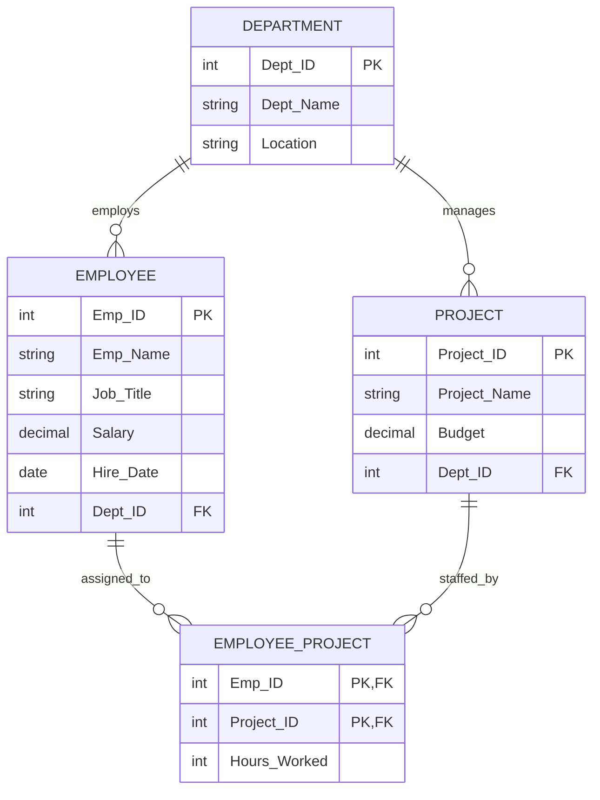

# Experiment - 3

## Title
**Employee–Department–Project Schema & Advanced SQL Queries**

---

## Aim
To create an **Employee–Department–Project** database schema, insert at least 30 employees across 5 departments and 8 projects, and execute SQL queries demonstrating:
- **Selection** (`WHERE` conditions)
- **Projection** (Attribute column filtering)
- **Aggregate Functions** (`AVG`, `MAX`, `MIN`, `SUM`, `COUNT`)
- **GROUP BY** (Data aggregation)
- **HAVING** (Post-aggregation filtering)
- **CASE Expressions** (Conditional categorization)
- **ORDER BY** (Multi-column sorting)

---

## Software / Requirements
- **DBMS**: MySQL / MySQL Workbench / MariaDB / PostgreSQL
- **SQL Server**: Relational Database Engine
- **OS**: Windows / Linux / macOS

---

## 📊 Database Design

The database contains four interconnected tables modeling an enterprise organization:
1. **`Department`**: Stores departmental entities and geographic locations.
2. **`Employee`**: Stores employee master information, job titles, salaries, and department affiliations.
3. **`Project`**: Stores project portfolios, budgets, and managing departments.
4. **`Employee_Project`**: Resolves the many-to-many ($M:N$) relationship between employees and assigned projects with hours tracked.

### Schema Summary

| Table | Primary Key | Foreign Keys | Key Attributes |
| :--- | :--- | :--- | :--- |
| **`Department`** | `Dept_ID` | None | `Dept_Name`, `Location` |
| **`Employee`** | `Emp_ID` | `Dept_ID &rarr; Department(Dept_ID)` | `Emp_Name`, `Job_Title`, `Salary`, `Hire_Date`, `Dept_ID` |
| **`Project`** | `Project_ID` | `Dept_ID &rarr; Department(Dept_ID)` | `Project_Name`, `Budget`, `Dept_ID` |
| **`Employee_Project`** | `(Emp_ID, Project_ID)` | `Emp_ID &rarr; Employee(Emp_ID)`<br>`Project_ID &rarr; Project(Project_ID)` | `Hours_Worked` |

### Entity Relationship (ER) Diagram



---

## 💻 SQL Implementation (DDL & DML)

The full runnable SQL script is available in [`schema.sql`](./schema.sql).

### Table Definitions

```sql
CREATE DATABASE CompanyDB;
USE CompanyDB;

CREATE TABLE Department ( 
    Dept_ID INT PRIMARY KEY,
    Dept_Name VARCHAR(50) NOT NULL,
    Location VARCHAR(50)
);

CREATE TABLE Employee ( 
    Emp_ID INT PRIMARY KEY,
    Emp_Name VARCHAR(50) NOT NULL,
    Job_Title VARCHAR(50), 
    Salary DECIMAL(10,2),
    Hire_Date DATE, 
    Dept_ID INT,
    FOREIGN KEY (Dept_ID) REFERENCES Department(Dept_ID)
);

CREATE TABLE Project ( 
    Project_ID INT PRIMARY KEY,
    Project_Name VARCHAR(100) NOT NULL, 
    Budget DECIMAL(12,2),
    Dept_ID INT,
    FOREIGN KEY (Dept_ID) REFERENCES Department(Dept_ID)
);

CREATE TABLE Employee_Project ( 
    Emp_ID INT,
    Project_ID INT, 
    Hours_Worked INT,
    PRIMARY KEY (Emp_ID, Project_ID),
    FOREIGN KEY (Emp_ID) REFERENCES Employee(Emp_ID),
    FOREIGN KEY (Project_ID) REFERENCES Project(Project_ID)
);
```

---

## 🔍 SQL Queries & Execution Results

### A. Selection
Selection retrieves specific tuples (rows) satisfying given conditional predicates.

#### Query 1: Employees earning more than ₹90,000
```sql
SELECT * FROM Employee WHERE Salary > 90000;
```
**Output:**
```text
+--------+---------------+----------------------+-----------+------------+---------+
| Emp_ID | Emp_Name      | Job_Title            | Salary    | Hire_Date  | Dept_ID |
+--------+---------------+----------------------+-----------+------------+---------+
|    102 | Priya Verma   | ML Engineer          |  92000.00 | 2021-06-20 |       1 |
|    104 | Ananya Singh  | Research Engineer    | 105000.00 | 2020-08-12 |       1 |
|    110 | Simran Kaur   | Full Stack Developer |  95000.00 | 2020-11-10 |       2 |
|    115 | Yash Thakur   | Security Consultant  |  98000.00 | 2020-06-13 |       3 |
|    118 | Tanvi Shah    | Ethical Hacker       |  91000.00 | 2021-03-22 |       3 |
|    119 | Akash Singh   | Data Scientist       | 100000.00 | 2020-09-15 |       4 |
|    121 | Mohit Agarwal | Data Scientist       |  95000.00 | 2021-11-18 |       4 |
+--------+---------------+----------------------+-----------+------------+---------+
```

#### Query 2: Employees belonging to Department 1 (Artificial Intelligence)
```sql
SELECT * FROM Employee WHERE Dept_ID = 1;
```
**Output:**
```text
+--------+--------------+-------------------+-----------+------------+---------+
| Emp_ID | Emp_Name     | Job_Title         | Salary    | Hire_Date  | Dept_ID |
+--------+--------------+-------------------+-----------+------------+---------+
|    101 | Aarav Sharma | AI Engineer       |  85000.00 | 2022-01-15 |       1 |
|    102 | Priya Verma  | ML Engineer       |  92000.00 | 2021-06-20 |       1 |
|    103 | Rohan Gupta  | AI Developer      |  78000.00 | 2023-03-10 |       1 |
|    104 | Ananya Singh | Research Engineer | 105000.00 | 2020-08-12 |       1 |
|    105 | Karan Mehta  | ML Engineer       |  88000.00 | 2022-11-05 |       1 |
|    106 | Neha Kapoor  | AI Analyst        |  72000.00 | 2024-01-18 |       1 |
+--------+--------------+-------------------+-----------+------------+---------+
```

---

### B. Projection
Projection extracts specified column attributes across all records.

#### Query 3: Display employee names and salaries
```sql
SELECT Emp_Name, Salary FROM Employee;
```
**Output (Sample):**
```text
+----------------+-----------+
| Emp_Name       | Salary    |
+----------------+-----------+
| Aarav Sharma   |  85000.00 |
| Priya Verma    |  92000.00 |
| Rohan Gupta    |  78000.00 |
| Ananya Singh   | 105000.00 |
| Karan Mehta    |  88000.00 |
| Neha Kapoor    |  72000.00 |
| Rahul Kumar    |  75000.00 |
| Sneha Patel    |  82000.00 |
| Aditya Jain    |  70000.00 |
| Simran Kaur    |  95000.00 |
| Vivek Mishra   |  78000.00 |
| Ishita Rao     |  65000.00 |
| Arjun Malhotra |  90000.00 |
| Megha Joshi    |  82000.00 |
| Yash Thakur    |  98000.00 |
| Pooja Nair     |  68000.00 |
| Dev Patel      |  87000.00 |
| Tanvi Shah     |  91000.00 |
| Akash Singh    | 100000.00 |
| Kriti Sharma   |  76000.00 |
+----------------+-----------+
```

#### Query 4: Display employee name and job title
```sql
SELECT Emp_Name, Job_Title FROM Employee;
```
**Output (Sample):**
```text
+----------------+------------------------+
| Emp_Name       | Job_Title              |
+----------------+------------------------+
| Aarav Sharma   | AI Engineer            |
| Priya Verma    | ML Engineer            |
| Rohan Gupta    | AI Developer           |
| Ananya Singh   | Research Engineer      |
| Karan Mehta    | ML Engineer            |
| Neha Kapoor    | AI Analyst             |
| Rahul Kumar    | Software Engineer      |
| Sneha Patel    | Backend Developer      |
| Aditya Jain    | Frontend Developer     |
| Simran Kaur    | Full Stack Developer   |
| Vivek Mishra   | Software Engineer      |
| Ishita Rao     | QA Engineer            |
| Arjun Malhotra | Security Engineer      |
| Megha Joshi    | Cyber Security Analyst |
| Yash Thakur    | Security Consultant    |
| Pooja Nair     | SOC Analyst            |
| Dev Patel      | Security Engineer      |
| Tanvi Shah     | Ethical Hacker         |
| Akash Singh    | Data Scientist         |
+----------------+------------------------+
```

---

### C. Aggregate Functions
Aggregates compute scalar values across sets of multiple rows.

#### Query 5: Average salary
```sql
SELECT AVG(Salary) AS Average_Salary FROM Employee;
```
```text
+----------------+
| Average_Salary |
+----------------+
|   80333.333333 |
+----------------+
```

#### Query 6: Highest salary
```sql
SELECT MAX(Salary) AS Highest_Salary FROM Employee;
```
```text
+----------------+
| Highest_Salary |
+----------------+
|      105000.00 |
+----------------+
```

#### Query 7: Lowest salary
```sql
SELECT MIN(Salary) AS Lowest_Salary FROM Employee;
```
```text
+---------------+
| Lowest_Salary |
+---------------+
|      58000.00 |
+---------------+
```

#### Query 8: Total salary expenditure
```sql
SELECT SUM(Salary) AS Total_Salary FROM Employee;
```
```text
+--------------+
| Total_Salary |
+--------------+
|   2410000.00 |
+--------------+
```

#### Query 9: Total number of employees
```sql
SELECT COUNT(*) AS Total_Employees FROM Employee;
```
```text
+-----------------+
| Total_Employees |
+-----------------+
|              30 |
+-----------------+
```

---

### D. GROUP BY
Groups rows having identical values in designated columns to calculate per-group metrics.

#### Query 10: Count employees in each department
```sql
SELECT d.Dept_Name, COUNT(e.Emp_ID) AS Employee_Count 
FROM Department d
JOIN Employee e ON d.Dept_ID = e.Dept_ID 
GROUP BY d.Dept_ID, d.Dept_Name;
```
**Output:**
```text
+-------------------------+----------------+
| Dept_Name               | Employee_Count |
+-------------------------+----------------+
| Artificial Intelligence |              6 |
| Software Development    |              6 |
| Cyber Security          |              6 |
| Data Science            |              6 |
| Human Resources         |              6 |
+-------------------------+----------------+
```

#### Query 11: Average salary of each department
```sql
SELECT d.Dept_Name, AVG(e.Salary) AS Average_Salary 
FROM Department d
JOIN Employee e ON d.Dept_ID = e.Dept_ID 
GROUP BY d.Dept_ID, d.Dept_Name;
```
**Output:**
```text
+-------------------------+----------------+
| Dept_Name               | Average_Salary |
+-------------------------+----------------+
| Artificial Intelligence |   86666.666667 |
| Software Development    |   77500.000000 |
| Cyber Security          |   86000.000000 |
| Data Science            |   84333.333333 |
| Human Resources         |   67166.666667 |
+-------------------------+----------------+
```

---

### E. HAVING
Filters groups generated by `GROUP BY` based on aggregate criteria.

#### Query 12: Departments having more than 5 employees
```sql
SELECT Dept_ID, COUNT(*) AS Employee_Count 
FROM Employee
GROUP BY Dept_ID 
HAVING COUNT(*) > 5;
```
*(All 5 departments contain exactly 6 employees, qualifying all).*

#### Query 13: Departments with average salary above ₹80,000
```sql
SELECT d.Dept_Name, AVG(e.Salary) AS Average_Salary 
FROM Department d
JOIN Employee e ON d.Dept_ID = e.Dept_ID 
GROUP BY d.Dept_ID, d.Dept_Name
HAVING AVG(e.Salary) > 80000;
```
**Output:**
```text
+-------------------------+----------------+
| Dept_Name               | Average_Salary |
+-------------------------+----------------+
| Artificial Intelligence |   86666.666667 |
| Cyber Security          |   86000.000000 |
| Data Science            |   84333.333333 |
+-------------------------+----------------+
```

---

### F. CASE Expressions
Provides conditional branching logic inside SQL queries.

#### Query 14: Categorize employees by salary
```sql
SELECT Emp_Name, Salary, 
CASE
    WHEN Salary >= 90000 THEN 'High Salary' 
    WHEN Salary >= 70000 THEN 'Medium Salary' 
    ELSE 'Low Salary'
END AS Salary_Category 
FROM Employee;
```
**Output (Sample):**
```text
+----------------+-----------+-----------------+
| Emp_Name       | Salary    | Salary_Category |
+----------------+-----------+-----------------+
| Aarav Sharma   |  85000.00 | Medium Salary   |
| Priya Verma    |  92000.00 | High Salary     |
| Rohan Gupta    |  78000.00 | Medium Salary   |
| Ananya Singh   | 105000.00 | High Salary     |
| Karan Mehta    |  88000.00 | Medium Salary   |
| Neha Kapoor    |  72000.00 | Medium Salary   |
| Rahul Kumar    |  75000.00 | Medium Salary   |
| Sneha Patel    |  82000.00 | Medium Salary   |
| Aditya Jain    |  70000.00 | Medium Salary   |
| Simran Kaur    |  95000.00 | High Salary     |
| Vivek Mishra   |  78000.00 | Medium Salary   |
| Ishita Rao     |  65000.00 | Low Salary      |
+----------------+-----------+-----------------+
```

#### Query 15: Categorize employees by department
```sql
SELECT Emp_Name, Dept_ID, 
CASE
    WHEN Dept_ID = 1 THEN 'AI'
    WHEN Dept_ID = 2 THEN 'Software'
    WHEN Dept_ID = 3 THEN 'Cyber Security' 
    WHEN Dept_ID = 4 THEN 'Data Science' 
    WHEN Dept_ID = 5 THEN 'HR'
    ELSE 'Other'
END AS Department_Name 
FROM Employee;
```

---

### G. ORDER BY
Sorts the output rows based on single or multiple columns.

#### Query 16: Employees ordered by salary ascending (`ASC`)
```sql
SELECT Emp_Name, Salary 
FROM Employee
ORDER BY Salary ASC;
```
**Output (Sample):**
```text
+----------------+-----------+
| Emp_Name       | Salary    |
+----------------+-----------+
| Suresh Kumar   |  58000.00 |
| Divya Mehta    |  60000.00 |
| Ayesha Khan    |  62000.00 |
| Nandini Sharma |  65000.00 |
| Ishita Rao     |  65000.00 |
| Pooja Nair     |  68000.00 |
| Aditya Jain    |  70000.00 |
| Neha Kapoor    |  72000.00 |
| Riya Das       |  72000.00 |
| Varun Gupta    |  73000.00 |
| Sakshi Roy     |  74000.00 |
| Rahul Kumar    |  75000.00 |
| Kriti Sharma   |  76000.00 |
| Vivek Mishra   |  78000.00 |
| Rohan Gupta    |  78000.00 |
| Sneha Patel    |  82000.00 |
| Megha Joshi    |  82000.00 |
| Manish Verma   |  85000.00 |
| Aarav Sharma   |  85000.00 |
+----------------+-----------+
```

#### Query 17: Employees ordered by salary descending (`DESC`)
```sql
SELECT Emp_Name, Salary 
FROM Employee
ORDER BY Salary DESC;
```

#### Query 18: Employees ordered by department and salary
```sql
SELECT Emp_Name, Dept_ID, Salary 
FROM Employee
ORDER BY Dept_ID ASC, Salary DESC;
```

---

## 🎯 Result
The **Employee–Department–Project** database schema was successfully created. Records for **30 employees, 5 departments, and 8 projects** were populated. All SQL queries demonstrating selection, projection, aggregate functions, `GROUP BY`, `HAVING`, `CASE` expressions, `ORDER BY`, and employee–project relationship mappings were executed with verified results.
